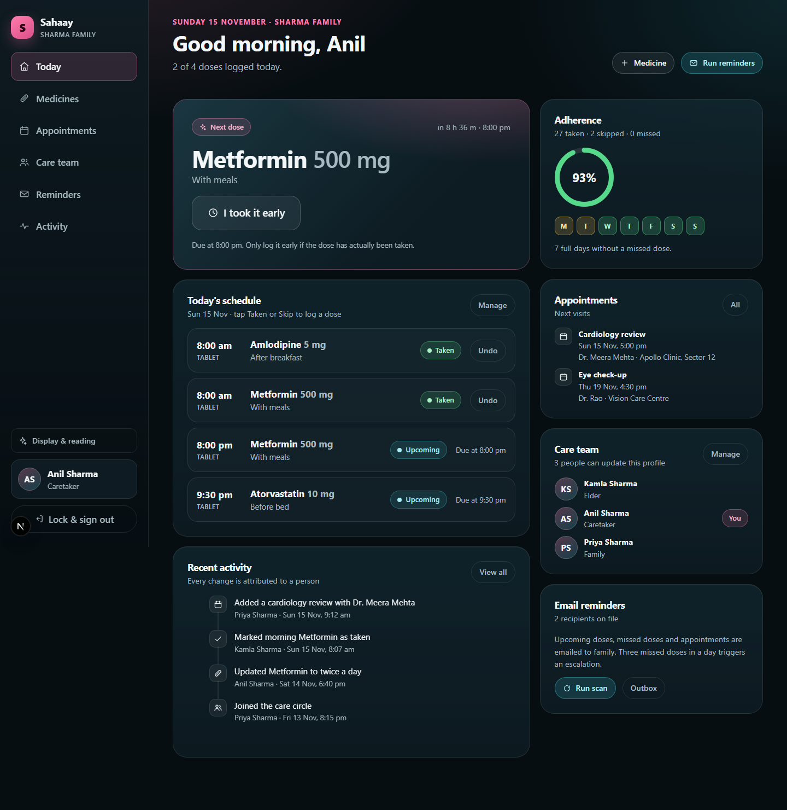
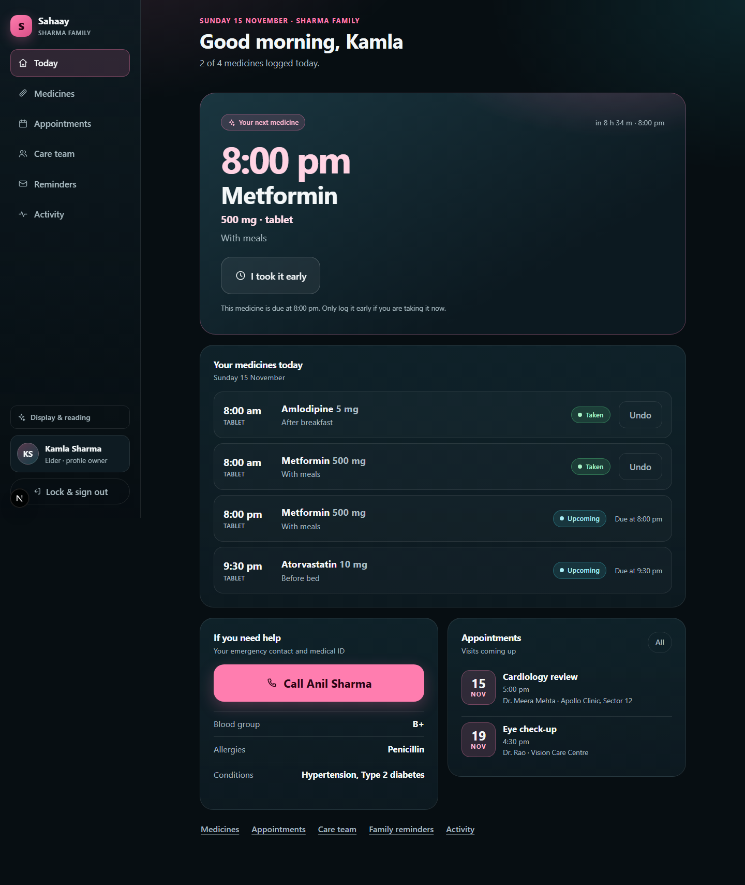
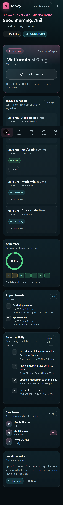
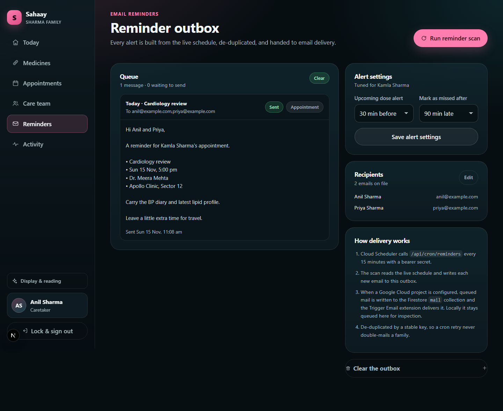
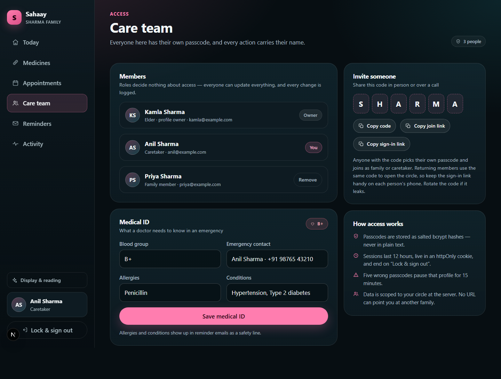

# Sahaay — one calm care circle for an elderly parent

Sahaay (Hindi for *help*) is a shared care companion for families managing an elderly parent's medication. The elder, the caretaker and the family share **one healthcare profile behind a family passcode** — and every reminder, dose and appointment leaves a named trail.

> **Live demo:** [sahaay-green-beta.vercel.app](https://sahaay-green-beta.vercel.app) — open the Sharma family demo circle, then use passcode `1234` (elder), `2580` (caretaker) or `1990` (family). Deploy notes: [`docs/DEPLOY.md`](docs/DEPLOY.md).



## The problem

- Families coordinate medication over phone calls and WhatsApp screenshots — nobody knows what was actually taken.
- Missed doses are discovered hours later, after the fact.
- Elderly users are handed password forms and tiny tap targets built for 20-year-olds.
- The elder disappears from the loop while relatives act *about* them, not *with* them.

## What Sahaay does

**One shared profile**
- A care circle has a single medical ID: blood group, allergies, conditions, emergency contact.
- Each person signs in with their **own 4–8 digit passcode**; roles (elder / caretaker / family) never gate access — everyone can update, and every change is attributed.
- Join with a 6-character invite code (`SHARMA` in the demo). Five wrong passcodes pause that profile for 15 minutes.
- The public landing lists **seeded demo profiles only**. A real circle is opened with its invite code, so no directory of families is exposed.

**Medication, not just reminders**
- Schedules per medicine: multiple times a day, chosen weekdays, start/end dates, pause without deleting.
- One-tap **Taken / Skip / Undo** from the dashboard or the schedule, with an optimistic-safe server action.
- Adherence engine: 7-day percentage, day-by-day strip, streaks, missed-today count.
- "Next dose" hero card shows the next real action instead of a wall of data.

**Appointments and the care loop**
- Upcoming visits with doctor, place and notes; past visits kept for history.
- Activity feed: who marked what, when.

**Quiet escalations by email**
| Trigger | When | Recipient |
| --- | --- | --- |
| Upcoming dose | Within the lead window (default 30 min) | Family + caretaker emails |
| Missed dose | After the grace window (default 90 min) | Family + caretaker |
| Escalation | 3+ missed doses in one day | Family + caretaker |
| Appointment | Within 24 hours | Family + caretaker |

Every message has a stable dedupe key, so a cron retry never double-mails a family.

**Built for the elder**
- Signing in as the elder opens a **calmer home**: an oversized clock and medicine name, one large *I took it* action, the emergency contact as a one-tap call, and the medical ID in plain language. Adherence charts and admin stay off that screen.
- A dose more than an hour away shows a countdown instead of Taken / Skip, so a morning tap cannot quietly log an evening pill.
- Three text sizes and a high-contrast theme, stored in cookies and applied server-side (no flash).
- Keypad login with large keys; 44 px minimum targets; visible focus; skip link; ARIA live regions; semantic landmarks; reduced-motion support.
- Every delete, remove and clear action needs a second confirming tap.
- Mobile layout reorders itself so adherence and appointments come before the activity feed.

<p>
  
  
</p>

<p>
  
  
</p>

## Architecture

```
Browser ── Next.js 15 server actions ── Repository ── node:sqlite (local / single instance)
                │                          └── Firestore adapter path
                ├── reminder engine (pure, tested)
                └── /api/cron/reminders ◀── Cloud Scheduler (15 min, bearer secret)
                          └── Firestore `mail` collection ── Trigger Email extension ── SMTP
```

- **Next.js 15 App Router**, React 19, TypeScript strict, hand-written CSS design system (no UI framework).
- **`node:sqlite`** via the built-in `DatabaseSync` — zero native build steps. Schema, demo seed and timezone-aware scheduling live in `src/lib`.
- **Passcode auth**: bcrypt (cost 10) hashes, HS256 JWT in an httpOnly `SameSite=Lax` cookie for 12 hours, per-circle scoping resolved from the session (never from the URL).
- **Validation**: every mutation parses with zod v4 before touching data.
- **Reminder engine** is a pure function (`buildReminderDrafts`) with injected `now` — deterministic and covered by tests.

### Google Cloud services

| Service | Role in Sahaay |
| --- | --- |
| **Vercel** | Hosts the public demo (Next.js native build, Edge network, daily cron) |
| **Cloud Run** | Optional self-hosted container (`output: "standalone"`, included `Dockerfile`), single instance |
| **Firestore + Trigger Email extension** | Queue documents in `mail`; the extension sends and retries delivery |
| **Cloud Scheduler** | Calls the reminder endpoint every 15 minutes with a bearer secret |
| **Secret Manager** | `SESSION_SECRET` and `CRON_SECRET`, mounted at runtime |
| **Cloud Logging / Monitoring** | Container logs and an uptime check on the Cloud Run URL |

`src/lib/delivery.ts` writes queued mail to Firestore through the REST API using the Cloud Run metadata token, keyed by the outbox message id so retries are idempotent. Outside Google Cloud it is a no-op and the in-app outbox remains the source of truth.

## Run it locally

```bash
npm install
npm run dev          # http://localhost:3000
```

No database or Google login required: SQLite is created at `data/sahaay.db` and seeded with a week of history, four medicines, three appointments and an activity feed.

**Demo passcodes** (care circle `Sharma family`)

| Profile | Role | Passcode |
| --- | --- | --- |
| Kamla Sharma | Elder | `1234` |
| Anil Sharma | Caretaker | `2580` |
| Priya Sharma | Family | `1990` |

Try the loop: sign in as Anil → mark the next dose → **Reminders → Run reminder scan** → open the generated email preview. Add a medicine from **Medicines → Add a medicine**, or invite someone with the code on **Care team**.

### Scripts

```bash
npm run dev      # dev server
npm run build    # production build (standalone output)
npm start        # serve the production build
npm run lint     # tsc --noEmit
npm test         # Vitest, 69 tests
```

## Tests

69 tests across 7 files, no network or database server required:

- `schedule` — slot expansion, weekday rules, start/end dates, due/upcoming/missed status, next-dose selection.
- `adherence` — taken/skipped/missed math, percentage, streaks, empty schedules.
- `reminders` — lead windows, grace windows, escalation, 24-hour appointments, recipient selection, stable dedupe keys.
- `store` — invite codes, elder-first ordering, cross-circle isolation, dose upserts, outbox dedupe.
- `auth` — bcrypt hashing, wrong-passcode counts, 15-minute lockout, unknown profiles.
- `validation` — every zod schema's accept/reject boundaries.
- `delivery` — Firestore no-op, successful handoff, failed handoff keeps the message queued.

```bash
npm test
```

## Security and privacy

- Passcodes are never stored or logged in plain text; hashes are salted per member.
- Sessions are signed, httpOnly and expire after 12 hours; production refuses to start without a 32+ character `SESSION_SECRET`.
- Every read and write is scoped to the circle in the signed session — a tampered id cannot reach another family.
- The public landing is a demo shelf: real circles are only reachable with their 6-character invite code.
- Server actions re-validate ownership, slot membership and schedule before recording a dose.
- Cron access requires a bearer secret; secrets come from Secret Manager in production.
- No third-party analytics or ad scripts; the app ships zero client-side trackers.

## Deploy

- **Vercel** (public demo): import the repo, set `SESSION_SECRET` and `CRON_SECRET`, deploy. Step-by-step in [`docs/DEPLOY.md#vercel`](docs/DEPLOY.md#vercel).
- **Cloud Run** (full Google Cloud stack): copy-paste `gcloud` commands for secrets, Firestore + Trigger Email, Cloud Run, Cloud Scheduler and smoke tests in the rest of [`docs/DEPLOY.md`](docs/DEPLOY.md).

## Project structure

```
src/app            routes: landing, setup, join, login, (app) shell, api/cron
src/app/actions.ts all server actions (auth, doses, medicines, appointments, scans)
src/components     design-system components (keypad, dose rows, forms, brand)
src/lib            db schema + seed, repository, time, schedule, adherence, reminders,
                   validation, auth, delivery
tests              Vitest suites and fixtures
docs               deployment guide and screenshots
```

## How this maps to the judging criteria

| Criterion | Where to look |
| --- | --- |
| Problem-statement alignment | Shared passcode profile, adherence, appointments, missed/upcoming email escalations |
| Code quality | Typed repository boundary, pure domain modules, server actions, zero `any` |
| Security | bcrypt + lockout, signed httpOnly sessions, per-circle scoping, zod validation, secrets |
| Efficiency | SQLite indexes, deduped reminder writes, no client state library, standalone image |
| Testing | 69 deterministic tests incl. auth lockout and cron dedupe |
| Accessibility | Text-size/contrast cookies, skip link, ARIA live regions, 44 px targets, mobile reflow |
| Google services | Cloud Run, Firestore Trigger Email, Cloud Scheduler, Secret Manager, Cloud Logging |

## Known limits

- SQLite is per-instance: the Cloud Run demo pins one instance and Vercel uses an ephemeral `/tmp`. `src/lib/store.ts` is the seam for a Firestore, Postgres or Cloud SQL repository.
- Reminders are email-only; SMS/WhatsApp would sit behind the same `buildReminderDrafts` output.
- The passcode model is intentionally simple for shared family devices; adding TOTP for caretakers is the next step.
